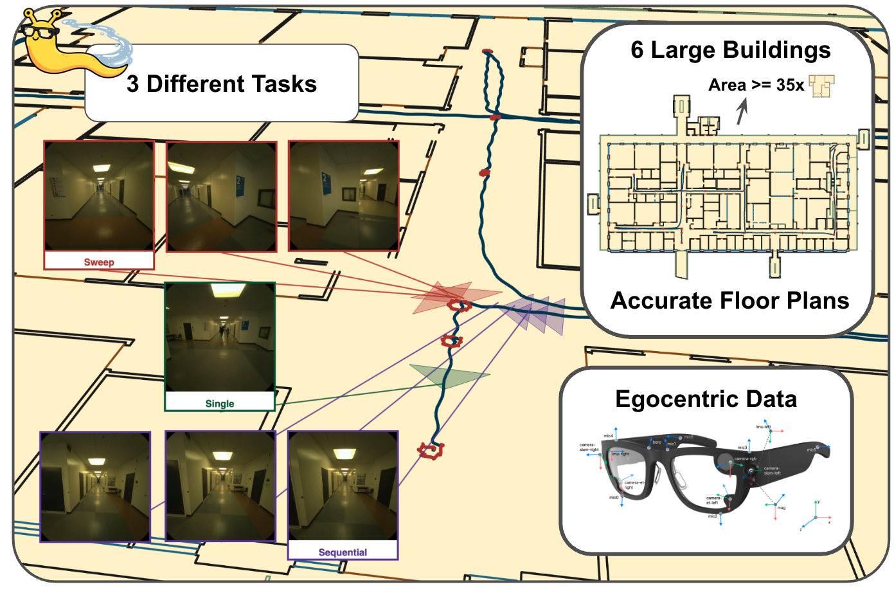
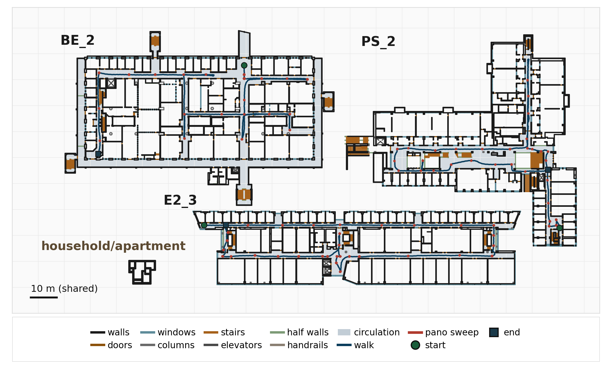

<div align="center">

#  SlugTrails: An Egocentric Benchmark for Floor Plan Localization in Large Buildings

<a href="https://arxiv.org/abs/2609.19876"></a>
<a href="https://huggingface.co/datasets/Head-inthe-Cloud/SlugTrails"></a>

<a href="#rerun-viewer"></a>

</div>

SlugTrails is a benchmark and dataset for **floor-plan-based indoor visual localization** in large-scale public buildings. It provides floor-plan-aligned egocentric recordings, standardized evaluation protocols, and tools for exploring the public **SlugTrails 1.0** package.

Existing floor-plan localization benchmarks predominantly focus on residential-scale environments. SlugTrails targets larger indoor spaces—especially **circulation** (corridors, lobbies, connectors)—where repetition and geometric ambiguity are hard.

---

## Dataset (SlugTrails 1.0)

**https://huggingface.co/datasets/Head-inthe-Cloud/SlugTrails**

Anonymized RGB, a blurred Aria VRS per session, Project Aria MPS trajectories, semidense point clouds, floor-plan maps, factor-graph ground truth in the map frame, and official evaluation / finetune manifests. File layout and checksums are on the dataset card (`README.md` on the Hub).

**Undistorted** means the linear pinhole image. **Fisheye** means the native distorted image stored in the VRS. Filenames say `undistorted`; the VRS paths do not repeat the word fisheye.

Each recording has an undistorted RGB video and a fisheye VRS:

- `rgb/camera-rgb_undistorted.mp4` is the upright undistorted RGB video (1408×1408). Blur was applied on these undistorted frames and is already baked into the MP4.
- `vrs/recording.vrs` is the fisheye file. It contains color `camera-rgb` plus grayscale `camera-slam-left` and `camera-slam-right`. Those three streams are blurred. IMU, audio, barometer, and calibration stay in the file. Eye-tracking images are copied through and are not blurred.

Fisheye blur labels ship under `vrs/blur/<stream>/boxes.json` for `camera-rgb`, `camera-slam-left`, and `camera-slam-right`. They were drawn on the upright fisheye image. The RGB fisheye list also includes faces at the rim of the fisheye, which fall outside the undistorted view. A `face` box is an ellipse and a `plate` box is a rectangle. A box also covers the next 30 unlabeled frames. `vrs/ORIENTATION.json` records the Gen1 upright rotation used when those boxes were applied.

Undistorting the VRS does not rebuild the shipped RGB MP4 (that blur was done in undistorted space). Undistorted SLAM MP4s are not in the download. Build an undistorted view of the already-blurred SLAM frames with the script below. The original unblurred VRS is not in the package. Pair the fisheye frames with the calibration inside the VRS. Pair the RGB MP4 with `metadata/camera-rgb_intrinsics_undistorted.json`.



BE_2, E2_3, and PS_2 drawn at the same scale as a household apartment. The bar is 10 m. Walks, panorama sweeps, and start/end marks are on the plans.

The download command is `hf` (the `huggingface-cli` name was removed in `huggingface_hub` 1.0). Install it, then download the whole package:

```bash
# recommended
curl -LsSf https://hf.co/cli/install.sh | bash
# or, inside an existing Python env:
pip install -U huggingface_hub
```

```bash
hf download Head-inthe-Cloud/SlugTrails \
  --repo-type dataset \
  --local-dir ./slugtrails-1.0
```

### Where to put it

`--root` is the directory that **directly** contains `maps/` and `recordings/`. The command above creates that directory as `./slugtrails-1.0` in the current working directory.

```
slugtrails-1.0/
  CHECKSUMS.sha256
  RELEASE.json
  README.md
  manifests/
  maps/<scene>/                 # BE_0, BE_1, BE_2, E2_2, E2_3, PS_2
  recordings/<id>/              # BE_0_0, BE_1_0, BE_2_0, E2_2_0, E2_3_0, PS_2_0
    rgb/
      camera-rgb_undistorted.mp4              # blur baked in undistorted space
      camera-rgb_frame_timestamps.npy
    vrs/recording.vrs                         # blurred fisheye RGB + both SLAM cameras
    vrs/blur/camera-rgb/boxes.json            # fisheye RGB labels
    vrs/blur/camera-slam-left/boxes.json
    vrs/blur/camera-slam-right/boxes.json
    vrs/ORIENTATION.json
    mps/{closed,open,slam}/     # trajectories + semidense_points.csv.gz
    gt_aligned/
    metadata/                   # undistorted RGB intrinsics
```

If you omit `--root`, both viewers search the current working directory for:

1. `./slugtrails-1.0`
2. `./data/hf_package/slugtrails-1.0`

Any other location is fine when you pass `--root /path/to/slugtrails-1.0`. `slugtrails-1.0/` is listed in `.gitignore`, so the download can sit beside this clone without being committed.

Check the download from inside the package root:

```bash
cd slugtrails-1.0
sha256sum -c CHECKSUMS.sha256
# macOS, if sha256sum is not installed:
shasum -a 256 -c CHECKSUMS.sha256
```

---

## Viewers (this repo)

Python ≥ 3.10. From a clone of this repository:

```bash
pip install -e .
# Rerun viewer (point cloud + video). The map viewer uses only the base install.
pip install -e ".[rerun]"
```

Console scripts after install: `slugtrails-view-map`, `slugtrails-view-rerun`, and (with `.[vrs]`) `slugtrails-undistort-vrs`. The `python -m` forms below work the same.

### 2D floor plan

```bash
python -m slugtrails.view_map --root ./slugtrails-1.0
```

Opens a matplotlib window: scene radio (`BE_0`, `BE_1`, `BE_2`, `E2_2`, `E2_3`, `PS_2`), per-layer CAD toggles (walls, doors, windows, and the rest of the map CSVs), and the `gt_aligned` trajectory for that scene’s recording. Coordinates are meters in the floor-plan frame.

```bash
python -m slugtrails.view_map --root ./slugtrails-1.0 --stem BE_2
python -m slugtrails.view_map --root ./slugtrails-1.0 --smoke   # load check, no window
```

### Rerun (point cloud + blurred RGB + map)

<a id="rerun-viewer"></a>

https://github.com/user-attachments/assets/ae455c86-2661-4c6b-bfd2-48f18390a5b4

Rerun viewer on a SlugTrails 1.0 recording: point cloud, floor plan, and anonymized RGB.

Needs the `[rerun]` extra (`rerun-sdk`, `projectaria-tools`).

```bash
python -m slugtrails.view_rerun --root ./slugtrails-1.0 --recording BE_0_0
python -m slugtrails.view_rerun --root ./slugtrails-1.0 --list
```

Recording ids: `BE_0_0`, `BE_1_0`, `BE_2_0`, `E2_2_0`, `E2_3_0`, `PS_2_0`.

The window is three panes: MPS 3D (trajectory + semidense cloud), floor plan, and the anonymized RGB video. Semidense points come from `recordings/<id>/mps/slam/semidense_points.csv.gz` inside the package. RGB is `recordings/<id>/rgb/camera-rgb_undistorted.mp4`.

Useful flags:

```bash
# shorter first look
python -m slugtrails.view_rerun --root ./slugtrails-1.0 --recording BE_0_0 \
  --max-frames 300 --stride 5

# browser instead of the desktop viewer
python -m slugtrails.view_rerun --root ./slugtrails-1.0 --recording BE_0_0 --web

# write a .rrd instead of opening a window
python -m slugtrails.view_rerun --root ./slugtrails-1.0 --recording BE_0_0 \
  --rrd BE_0_0.rrd --max-frames 300
```

A `.rrd` file is a Rerun recording: the logged point cloud, floor plan, and frames, saved instead of opening a window. Open it later with `rerun BE_0_0.rrd`.

The video pane uses `recordings/<id>/rgb/camera-rgb_undistorted.mp4`. For the 3D camera frustum, pass the package VRS: `--vrs ./slugtrails-1.0/recordings/BE_0_0/vrs/recording.vrs`.

### Inspect the VRS (fisheye RGB and SLAM cameras)

`view_rerun` shows the anonymized RGB MP4, not the fisheye streams. To open `vrs/recording.vrs` itself, use Meta’s Aria Rerun viewer from `projectaria-tools` (already installed with `.[rerun]` or `.[vrs]`):

```bash
pip install -e ".[rerun]"   # or: pip install -e ".[vrs]"
python -m projectaria_tools.tools.aria_rerun_viewer.aria_rerun_viewer \
  --vrs ./slugtrails-1.0/recordings/BE_0_0/vrs/recording.vrs \
  --enabled-streams camera-rgb camera-slam-left camera-slam-right \
  --subsample-rates camera-rgb=10 camera-slam-left=10 camera-slam-right=10
```

Subsample is required for a smooth first look. Full-rate logging of a multi‑GB VRS will stall Rerun.

### Undistort the VRS (SLAM cameras)

For undistorted RGB, use `rgb/camera-rgb_undistorted.mp4` directly. Its blur was applied on the undistorted frames. Running the script on `camera-rgb` undistorts frames that were already blurred as fisheye, so it is a different video.

The script is for an undistorted view of the already-blurred SLAM cameras (`camera-slam-left`, `camera-slam-right`):

```bash
pip install -e ".[vrs]"
python -m slugtrails.undistort_vrs \
  --vrs ./slugtrails-1.0/recordings/BE_0_0/vrs/recording.vrs \
  --streams camera-slam-left camera-slam-right \
  --out ./undistorted/BE_0_0
```

One stream at a time: `--streams camera-slam-left`. Each stream writes `{stream}_undistorted.mp4`, `{stream}_frame_timestamps.npy`, and `{stream}_intrinsics_undistorted.json` (undistorted intrinsics for that MP4). Aria Gen1 frames are rotated upright, the same way as the shipped RGB video.

---

## Benchmark

SlugTrails evaluates floor-plan localization methods across single-frame, multi-view, and sequential settings, including transfer from residential-scale data and fine-tuning on large-building sessions.

Full evaluation harness and baseline adapters will continue to land in this repository; protocol details and frozen splits ship with the HF package (`manifests/`).

---

## Paper

Cheng & Manduchi — *SlugTrails: An Egocentric Benchmark for Floor Plan Localization in Large Buildings* (2026). [arXiv:2609.19876](https://arxiv.org/abs/2609.19876)

---

## License

SlugTrails dataset and the code in this repository are released under
**[CC BY 4.0](https://creativecommons.org/licenses/by/4.0/)** (see `LICENSE`).

---

## Citation

```bibtex
@inproceedings{Cheng2026SlugTrailsAE,
  title={SlugTrails: An Egocentric Benchmark for Floor Plan Localization in Large Buildings},
  author={Yunqian Cheng and Roberto Manduchi},
  year={2026}
}
```

Update the entry upon publication if the venue bibtex changes.

---

## Contact

Questions about the dataset or viewers: open a GitHub issue in this repository, or email ychen827@ucsc.edu.
